# 小遥账单桌面版

> 隐私优先的个人账单分析桌面应用：完全离线、数据本地持久化，并可通过 MCP 交给 AI Agent 分析。

[](https://tauri.app/)
[](https://www.rust-lang.org/)
[](https://vuejs.org/)
[](https://www.microsoft.com/windows)
[](https://www.apple.com/macos/)
[](https://modelcontextprotocol.io/)
[](https://opensource.org/licenses/MIT)

[English](README_EN.md) | 简体中文

<p align="center">
  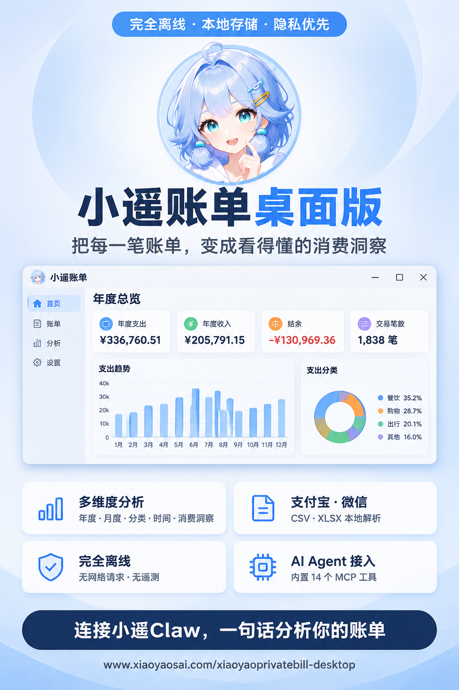
</p>

**产品官网**：<https://www.xiaoyaosai.com/xiaoyaoprivatebill-desktop/>

---

## 1. 简介

小遥账单桌面版是一个**隐私优先**的个人账单分析工具。它可以导入支付宝、微信账单，在本机完成解析、统计与可视化，不依赖任何服务器；内置 MCP 服务，可被 **小遥Claw** 直接调用，用自然语言完成账单分析。

**核心特点**：

- 🔒 **完全离线** - 应用本身不发起任何出站请求，无遥测、无 CDN、无自动更新
- 💾 **本地持久化** - 账单保存在本机应用数据目录，随时手动清理
- 📊 **多维度分析** - 年度总览、月度分析、分类分析、时间分析、消费洞察
- 📁 **多格式支持** - 支付宝 CSV、微信 CSV / XLSX，自动识别文件来源
- 🤖 **Agent 可调用** - 内置 14 个 MCP 工具，用自然语言查账、做分析
- 🖥️ **桌面原生** - 自绘标题栏、可收起侧边栏、系统托盘、单实例、窗口状态记忆、拖拽导入
- 🗑️ **可恢复删除** - 回收站、快照、审计日志，降低误操作风险
- 🖼️ **一键分享海报** - 年度 / 月度海报、3 套模板、金额逐项开关，自带官网二维码
- 🧬 **与 Web 版同源** - 视觉与统计口径与 [Web 版](https://github.com/dtsola/xiaoyaoprivatebill) 一致

---

## 2. 作者介绍

<p align="center">
  
</p>

<p align="center">
  <b>dtsola</b> — IT 解决方案架构师 | 一人公司实践者
</p>

<p align="center">
  🌐 <a href="https://www.dtsola.com">个人站点</a> &nbsp;|&nbsp;
  📺 <a href="https://space.bilibili.com/736015">B站</a> &nbsp;|&nbsp;
  💬 微信：dtsola（技术交流 | 商务合作）
</p>

<p align="center">
  
  &nbsp;&nbsp;&nbsp;&nbsp;&nbsp;&nbsp;
  
  &nbsp;&nbsp;&nbsp;&nbsp;&nbsp;&nbsp;
  
</p>

<p align="center">
  <small>微信联系 &nbsp;&nbsp;&nbsp;&nbsp;&nbsp;&nbsp;&nbsp;&nbsp; 开发者交流群 &nbsp;&nbsp;&nbsp;&nbsp;&nbsp;&nbsp;&nbsp;&nbsp; 用户交流群</small>
</p>

---

## 3. 功能预览

> 以下截图均来自桌面版实机运行，演示数据共 7,396 条。

### 首页 - 功能入口

<table>
<tr>
<td width="50%">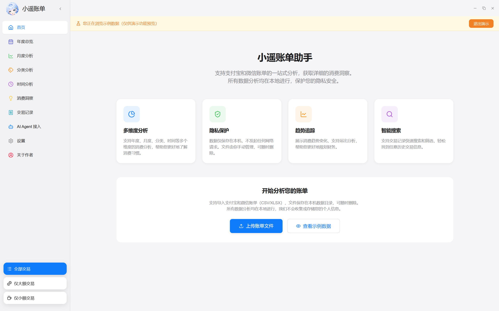</td>
<td width="50%">
<ul>
<li>🎯 支付宝与微信账单的一站式分析入口</li>
<li>📊 多维度分析、隐私保护、趋势追踪、智能搜索四张能力卡片</li>
<li>🚀 导入真实账单，或一键加载演示数据</li>
</ul>
</td>
</tr>
</table>

### 上传账单 - 原生导入

<table>
<tr>
<td width="50%">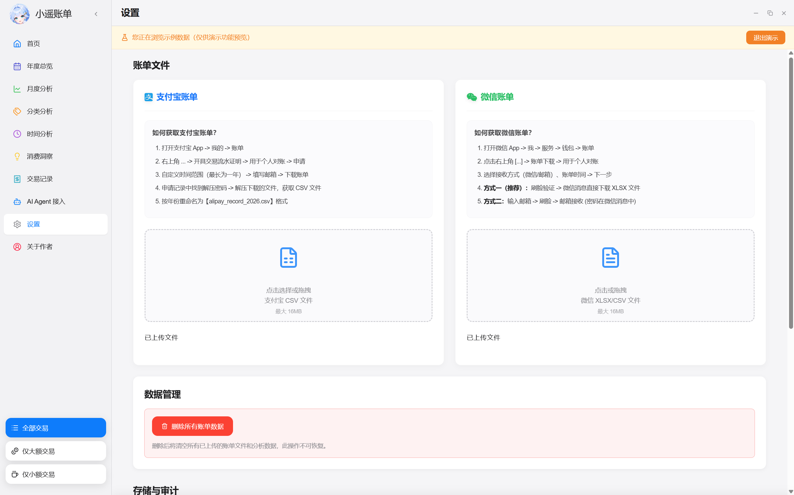</td>
<td width="50%">
<ul>
<li>📤 原生文件对话框，支持多选与全窗口拖拽</li>
<li>📋 自动识别支付宝 / 微信账单格式与编码</li>
<li>⚡ 本地解析，不上传任何服务器</li>
</ul>
</td>
</tr>
</table>

### 年度总览 - 一目了然

<table>
<tr>
<td width="50%">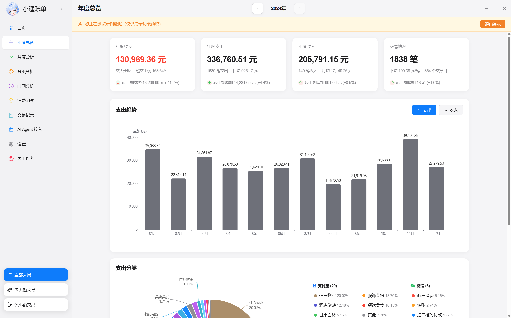</td>
<td width="50%">
<ul>
<li>📊 年度收支、结余、交易笔数与同比</li>
<li>📈 12 个月支出趋势与收入切换</li>
<li>🥧 支出分类占比与来源分布</li>
</ul>
</td>
</tr>
</table>

### 分享海报 - 一键传播

<table>
<tr>
<td width="50%">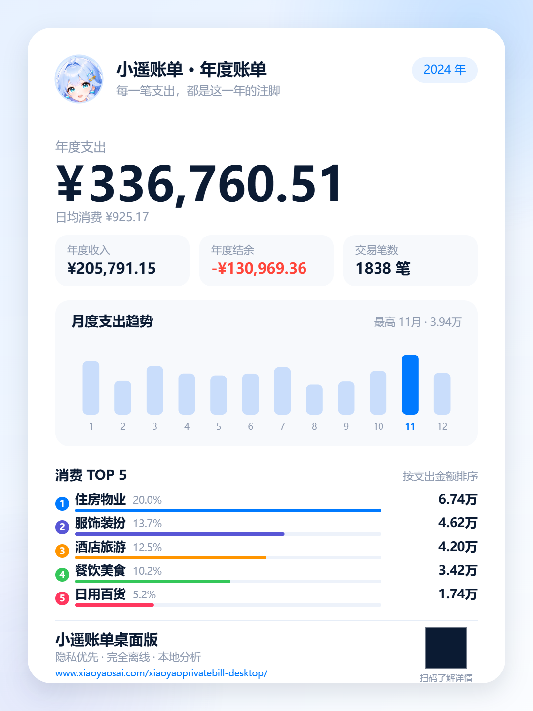</td>
<td width="50%">
<ul>
<li>🖼️ 侧边栏「分享海报」直接进入，年度总览也可一键生成</li>
<li>📐 支持年度 / 月度范围，1080×1440 竖版海报</li>
<li>🎨 3 套模板，支出、收入、结余、分类、峰值金额可逐项开关</li>
<li>🔒 可隐藏金额后再分享，敏感数字不会出现在图片里</li>
<li>📱 海报自带产品官网二维码，方便发朋友圈、小红书、微博、抖音</li>
</ul>
</td>
</tr>
<tr>
<td width="50%">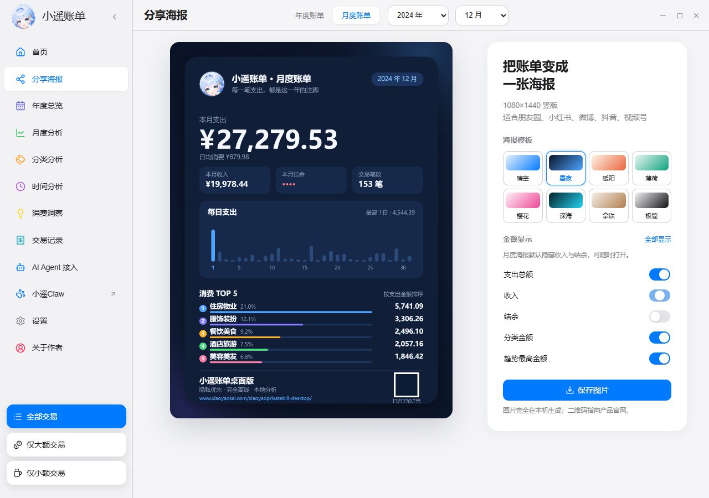</td>
<td width="50%">
<ul>
<li>🌙 月度账单：每日支出趋势 + 本月消费 TOP 5</li>
<li>🎨 「墨夜」「暖阳」模板一键切换</li>
<li>🔁 金额逐项开关，月度默认隐藏收入与结余</li>
<li>📅 当月数据未完整时自动标注「数据截至 X 日」</li>
</ul>
</td>
</tr>
</table>

### 月度分析 - 精细对比

<table>
<tr>
<td width="50%">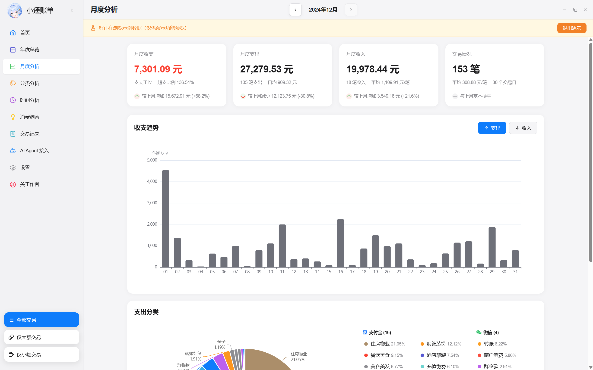</td>
<td width="50%">
<ul>
<li>📅 月度收支、环比与日均</li>
<li>🗓️ 每日消费日历</li>
<li>📉 月度对比与分类明细</li>
</ul>
</td>
</tr>
</table>

### 分类分析 - 花费明细

<table>
<tr>
<td width="50%">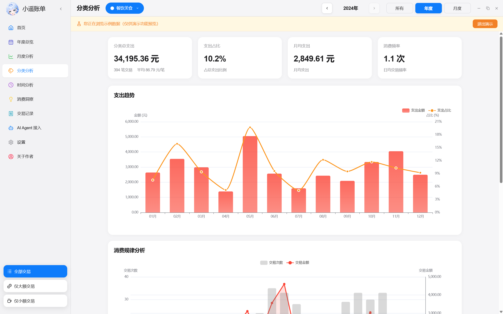</td>
<td width="50%">
<ul>
<li>🏷️ 分类占比与排行</li>
<li>📊 分类趋势与时段分布</li>
<li>📝 单分类明细下钻</li>
</ul>
</td>
</tr>
</table>

### 时间分析 - 消费规律

<table>
<tr>
<td width="50%">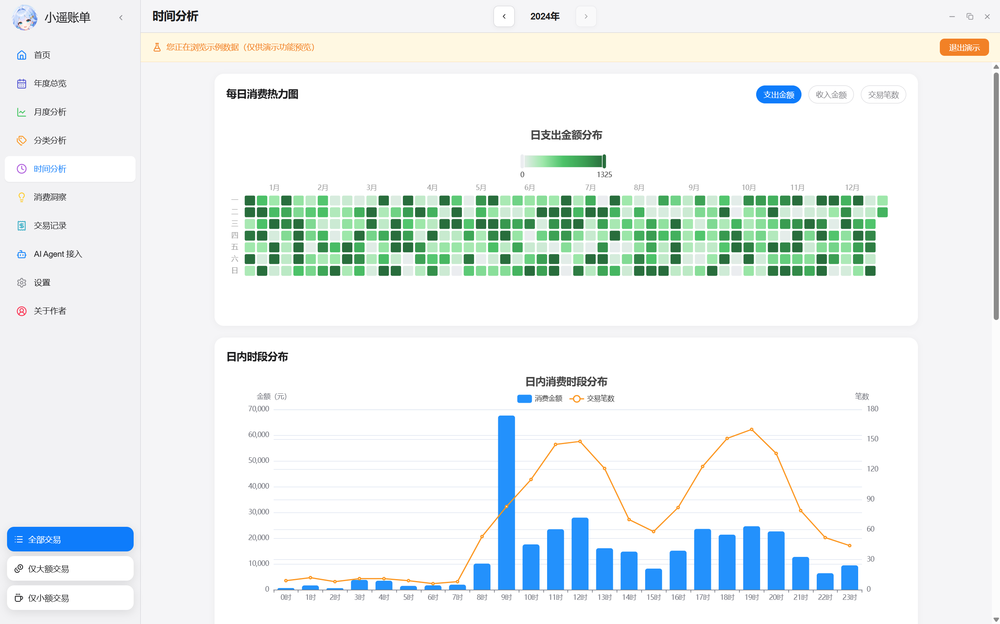</td>
<td width="50%">
<ul>
<li>⏰ 24 小时消费分布</li>
<li>🌡️ 日历热力图</li>
<li>📈 工作日 / 周末对比</li>
</ul>
</td>
</tr>
</table>

### 消费洞察 - 智能分析

<table>
<tr>
<td width="50%">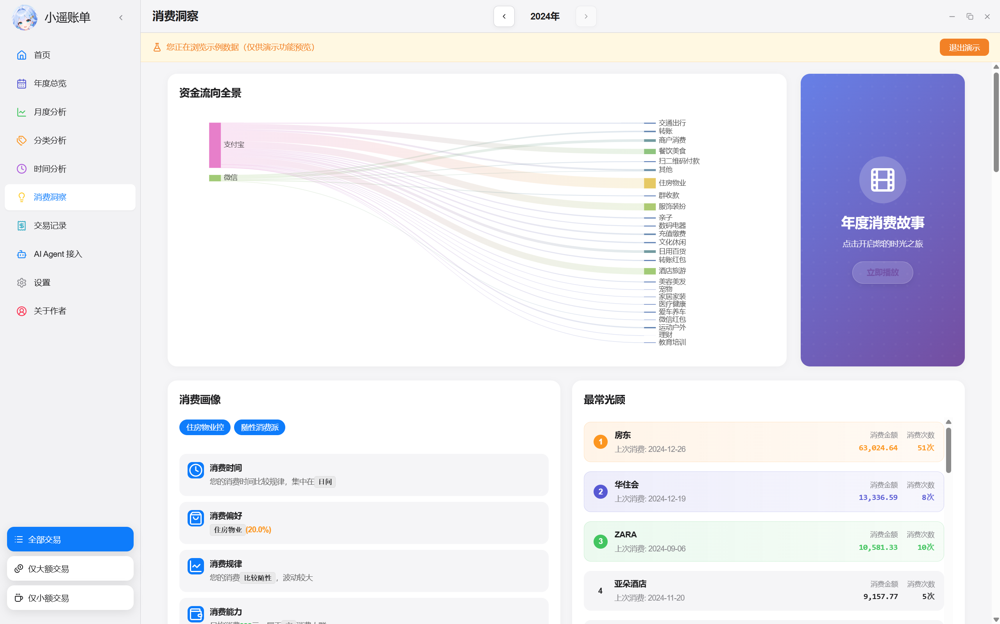</td>
<td width="50%">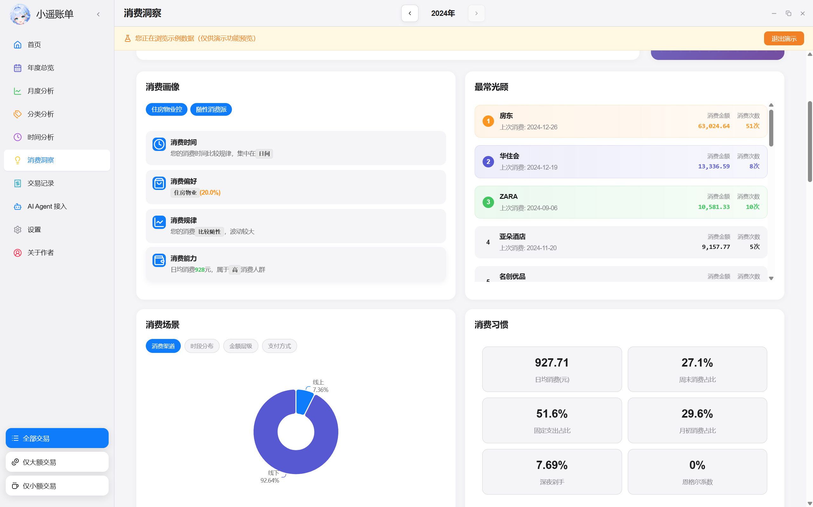</td>
</tr>
<tr>
<td width="50%">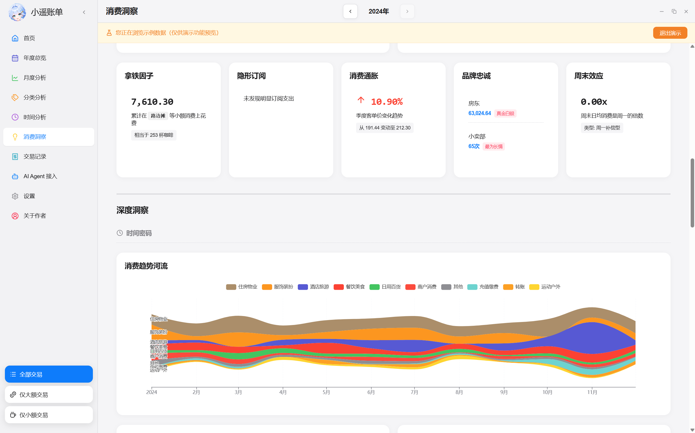</td>
<td width="50%">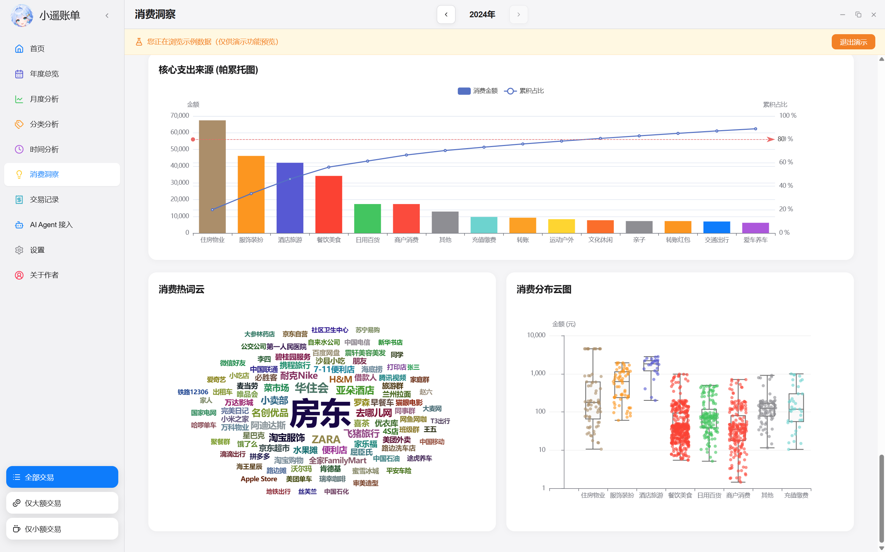</td>
</tr>
</table>

- 💡 消费习惯与用户画像
- 🔍 异常消费、拿铁因子与深夜消费
- 📊 订阅扣费、恩格尔系数与消费结构

### 交易记录 - 明细查询

<table>
<tr>
<td width="50%">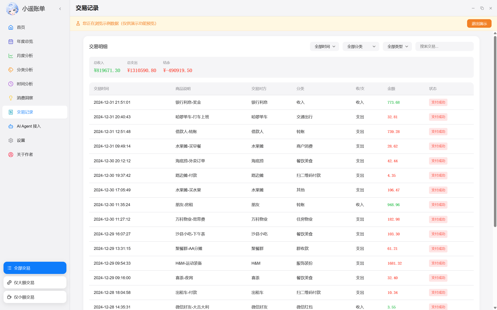</td>
<td width="50%">
<ul>
<li>📋 完整交易明细</li>
<li>🔍 关键词搜索与多维筛选</li>
<li>📄 分页浏览与快速跳转</li>
</ul>
</td>
</tr>
</table>

---

## 4. AI Agent 接入（以小遥Claw 为例）

<p align="center">
  <a href="https://www.xiaoyaosai.com/xiaoyaoclaw/"></a>
</p>

**小遥Claw** 是一款把 AI 助手装进你自己电脑的桌面 Personal Agent：它在本地运行，可以连接本机工具与数据，用自然语言替你完成任务。

小遥账单桌面版为小遥Claw 内置了标准 Streamable HTTP MCP 服务。开启后，你只需要对小遥Claw 说一句「帮我分析一下我的小遥账单」，它就会自动调用账单工具，读取年度、月度、分类、时间与消费洞察数据，生成结构化的分析报告。账单数据保存在你的电脑上，是否交给模型分析由你在小遥Claw 中配置决定。

**小遥Claw 官网**：<https://www.xiaoyaosai.com/xiaoyaoclaw/>

### 4.1 在应用中开启 MCP

1. 打开侧边栏「**AI Agent 接入**」。
2. 打开 MCP 开关，状态显示「运行中」。
3. 服务固定监听 `http://127.0.0.1:17650/mcp`，仅回环地址，不对局域网或公网开放。
4. 点击「**复制 MCP 配置**」，得到小遥Claw 可直接使用的标准 JSON。

> MCP 默认关闭。开启后，本机程序可读取你的全部账单；数据是否离开本机，取决于调用方 Agent 及其所配置的模型。

配置格式如下（Token 由应用生成，请以复制结果为准）：

```json
{
  "type": "http",
  "url": "http://127.0.0.1:17650/mcp",
  "headers": {
    "Authorization": "Bearer <TOKEN>"
  }
}
```

### 4.2 在小遥Claw 中添加服务

<table>
<tr>
<td width="50%">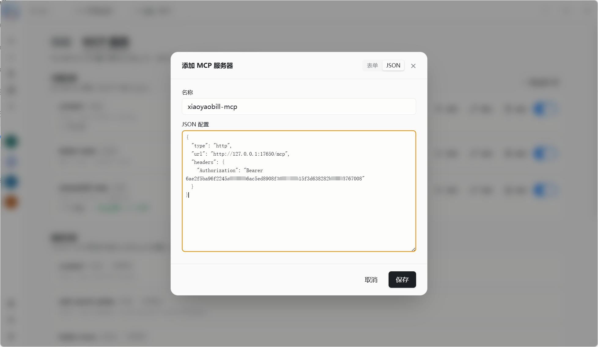</td>
<td width="50%">
<ol>
<li>打开小遥Claw「设置 → 技能与 MCP」</li>
<li>点击「添加服务器」，名称可填 <code>xiaoyaobill-mcp</code></li>
<li>切换到「JSON」页签，粘贴上一步复制的配置</li>
<li>点击「保存」</li>
</ol>
</td>
</tr>
</table>

### 4.3 测试连接

<table>
<tr>
<td width="50%"></td>
<td width="50%">
<ul>
<li>✅ 显示「连接正常 · 14 个工具」</li>
<li>🔑 凭据为应用生成的 Bearer Token</li>
<li>🔄 保存后下一条消息生效，无需重启小遥Claw</li>
</ul>
</td>
</tr>
</table>

### 4.4 用自然语言分析账单

在小遥Claw 中直接提问，例如「帮我分析一下我的小遥账单」：

<table>
<tr>
<td width="50%">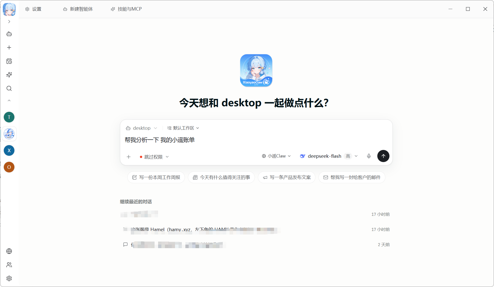</td>
<td width="50%">
<ul>
<li>🗣️ 无需记工具名，Agent 会自动选择 MCP 工具</li>
<li>📊 可组合总览、年度、月度、分类、洞察等多次调用</li>
<li>📝 输出年度总览、钱花在哪、消费建议等结构化结论</li>
</ul>
</td>
</tr>
</table>

<p align="center">
  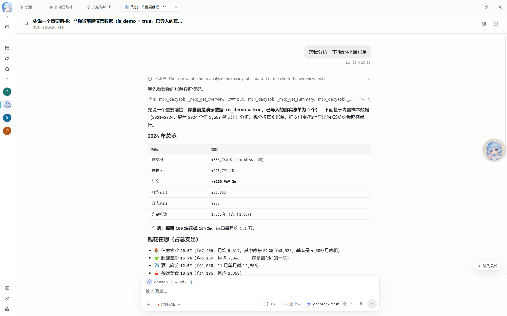
</p>

> 图中为演示数据。导入真实账单后，Agent 读取到的即为你本机的最新数据；若当前处于演示模式，Agent 会提示 `is_demo = true`。

### 4.5 14 个 MCP 工具

| 类型 | 工具 |
|---|---|
| 读（10） | `list_bills`、`get_overview`、`get_summary`、`get_yearly_analysis`、`get_monthly_analysis`、`get_category_analysis`、`search_transactions`、`get_time_analysis`、`get_insights`、`get_audit_log` |
| 写（4） | `import_bill`、`delete_bill`、`restore_bill`、`clear_data` |

写操作有护栏：`import_bill` 仅接受绝对路径且 ≤16MB；`delete_bill` 软删除到回收站；`clear_data` 必须先快照；所有写操作写入审计日志。演示模式下禁止一切写操作。

### 4.6 安全提示

- Token 为 32 字节随机数，可在应用内重新生成；重新生成后旧连接立即失效。
- 服务只监听 `127.0.0.1`，不监听局域网或公网。
- 回收站、快照、审计日志**永不自动清理**，请在应用内手动清理。
- 若不需要 Agent 访问，请保持 MCP 关闭。
- Agent 可能把工具返回的数据发送给其所配置的大模型；请自行评估该模型的隐私边界。

---

## 5. 安装

> **未签名提示**：当前 Windows 与 macOS 安装包均未做代码签名 / 公证，系统可能弹出安全提示。Windows 选择「更多信息 → 仍要运行」；macOS 右键应用选择「打开」，或到「系统设置 → 隐私与安全性 → 仍要打开」。这是开源项目未购买签名证书时的正常提示，不影响应用功能。

### 5.1 下载渠道

| 渠道 | 地址 | 说明 |
|---|---|---|
| GitHub Releases（推荐） | [dtsola/xiaoyaoprivatebill-desktop/releases](https://github.com/dtsola/xiaoyaoprivatebill-desktop/releases) | 始终是最新版本 |
| 百度网盘（备用） | [pan.baidu.com/s/1SvLc23guuKuIscDArX79QQ](https://pan.baidu.com/s/1SvLc23guuKuIscDArX79QQ?pwd=d262) | 提取码 `d262`，国内下载更快 |

一个版本只需下载对应平台的一个文件：

| 平台 | 文件名 |
|---|---|
| Windows x64 | `XiaoyaoBillDesktop_<版本>_x64-setup.exe` |
| macOS（Intel + Apple Silicon 通用） | `XiaoyaoBillDesktop_<版本>_universal.dmg` |

> Release 页面里的 `*.app.tar.gz` 是应用内自动更新使用的归档，不是安装包，普通用户无需下载。
>
> 如对第三方安装包有疑虑，可以按[开发构建](#7-开发构建)从源码自行编译。

### 5.2 Windows 10 / 11（x64）

1. 从上述任一渠道下载 `*-setup.exe`。
2. 双击安装，按向导完成；安装范围为当前用户，无需管理员权限。
3. 从开始菜单启动「XiaoyaoBillDesktop」（小遥账单桌面版）。

> **SmartScreen 提示**：若出现「Windows 已保护你的电脑」，点击「更多信息」→「仍要运行」。发布者显示为「未知发布者」属于未签名安装包的正常现象；SmartScreen 会记住该选择，后续启动不再提示。

> Windows 10 若未安装 WebView2，安装器会联网自动下载并安装（Windows 11 自带）。若自动安装失败，可手动安装 [WebView2 Runtime](https://developer.microsoft.com/microsoft-edge/webview2/)。

### 5.3 macOS 11+（Intel / Apple Silicon）

1. 从上述任一渠道下载通用 `.dmg`：`*_universal.dmg`（Intel + Apple Silicon 同一包）。
2. 打开 dmg，将应用拖入「应用程序」。
3. **首次打开**：右键点击应用 →「打开」；或到「系统设置 → 隐私与安全性」点击「仍要打开」。
4. macOS 15 如仍被拦截，可在终端执行：

```bash
xattr -dr com.apple.quarantine "/Applications/XiaoyaoBillDesktop.app"
```

> 当前版本**未签名、未公证**，因此会出现上述提示；这在未购买签名证书的开源项目中很常见。

### 5.4 系统要求

| 项 | 要求 |
|---|---|
| Windows | Windows 10 / 11 x64；WebView2 缺失时安装器自动下载 |
| macOS | macOS 11+；Intel 或 Apple Silicon |
| 磁盘 | 安装包约 20MB；数据目录随账单增长 |
| 网络 | **不需要**；断网可完整使用 |

### 5.5 数据目录与卸载

| 平台 | 数据目录 |
|---|---|
| Windows | `%APPDATA%\xiaoyaobill-desktop` |
| macOS | `~/Library/Application Support/xiaoyaobill-desktop` |

- 卸载应用**不会**删除数据目录；如需彻底清除，请手动删除上述目录。
- 备份时复制整个数据目录即可；`bills/` 是唯一真源。

---

## 6. 快速开始

### 6.1 获取账单文件

**支付宝账单**：

1. 打开支付宝 App → 账单。
2. 点击右上角「常见问题」→ 导出账单。
3. 选择「个人账单」→ 时间范围 → 选择 CSV 格式。
4. 输入邮箱，等待接收账单文件。

**微信账单**：

1. 打开微信 → 我 → 服务 → 钱包 → 右上角「账单」。
2. 点击「常见问题」→ 下载账单。
3. 选择时间范围 → 输入邮箱 → 选择 CSV 或 XLSX 格式。

### 6.2 导入并分析

1. 打开应用，点击「上传账单」或进入「设置」。
2. 在支付宝 / 微信上传区选择文件，或直接把账单拖入窗口。
3. 等待解析完成；随后可查看年度、月度、分类、时间、洞察与明细。
4. 如需先体验，点击「查看示例数据」加载内置 7,396 条演示数据。

### 6.3 演示模式

- 演示模式下可浏览全部分析页面。
- 演示模式下**禁止**导入、删除、清空，以及所有 MCP 写操作。
- 退出演示后回到真实数据。

---

## 7. 开发构建

### 7.1 前置要求

| 工具 | 版本 |
|---|---|
| Rust | 1.95+（MSVC 工具链，Windows） |
| Node.js | 20 LTS 或 24 |
| npm | 10+ |
| Visual Studio Build Tools | 2022（Windows，含 VC Tools） |
| WebView2 | Windows 10 / 11 |
| Python | 3.10（仅 golden 对账，不进入产物） |

### 7.2 本地开发

```bash
# 1. 克隆仓库
git clone https://github.com/dtsola/xiaoyaoprivatebill-desktop.git
cd xiaoyaoprivatebill-desktop

# 2. 安装依赖
npm install
npm --prefix frontend install

# 3. 启动开发模式（Vite + Tauri）
npm run tauri dev

# 4. 仅前端开发
npm --prefix frontend run dev
```

### 7.3 构建安装包

```bash
# 构建前端
npm --prefix frontend run build

# 本机调试构建（Windows NSIS）
npm run tauri build -- --bundles nsis
# 产物：target/release/bundle/nsis/*-setup.exe
```

正式发布统一走 GitHub Actions：`.github/workflows/release.yml` 同时构建 Windows NSIS 与 macOS universal dmg（Intel + Apple Silicon），推送 `v*` tag 或手动触发。产物分别为 `*_x64-setup.exe` 与 `*_universal.dmg`。

### 7.4 质量与对账

```bash
cargo fmt --check
cargo clippy --workspace -- -D warnings
cargo test --workspace

# 前端单元测试 + Playwright 桌面端验收
npm run test:unit
npm run test:e2e

# golden 对账（需 Python 3.10 + Web 版 backend）
python tools/golden/generate.py --out fixtures/expected --check --web-root <Web 仓库>/backend

# 前端冻结基线校验
node scripts/check-frontend-baseline.mjs
```

前端只允许修改 8 个适配文件与 9 个图标迁移文件；其余页面、组件、store 与全局样式保持冻结，由基线脚本做 CI 门禁。

---

## 8. 文档

| 文档 | 说明 |
|---|---|
| [市场需求文档（MRD）](docs/00-mrd.md) | 市场问题、目标用户、竞品、成功指标 |
| [产品需求文档（PRD）](docs/01-prd.md) | 功能清单、桌面行为、MCP、页面、验收 |
| [原型与视觉标准](docs/02-原型+视觉.md) | 页面基线、组件、桌面分组、导入交互、文案与视觉验收 |
| [技术方案文档](docs/03-技术方案文档.md) | Tauri + Rust 架构、27 接口、存储、安全、打包 |
| [开发任务清单](docs/04-开发任务清单.md) | 61 个任务、工时、里程碑、质量门禁 |
| [开发排期](docs/05-开发排期.md) | D1–D22、关键路径、风险 |
| [开发进度](docs/开发进度.md) | 当前进度、Web 基线、技术债 |
| [架构决策](docs/架构决策/) | Tauri Spikes、MCP schema 兼容等决策记录 |

---

## 9. 致谢

- 本项目的前端与产品设计同源于 [dtsola/xiaoyaoprivatebill](https://github.com/dtsola/xiaoyaoprivatebill)（Web 版，已冻结）。
- Web 版最初重构自 [alipay_record_analysis](https://github.com/Hessel2333/alipay_record_analysis)，感谢原作者 **Hessel2333**。
- 桌面端基于 [Tauri](https://tauri.app/)、[Rust](https://www.rust-lang.org/)、[Vue 3](https://vuejs.org/)、[ECharts](https://echarts.apache.org/)、[rmcp](https://github.com/modelcontextprotocol/rust-sdk)、[Lucide](https://lucide.dev/)。
- AI Agent 示例使用 [小遥Claw](https://www.xiaoyaosai.com/xiaoyaoclaw/)。

---

## 10. 贡献指南

欢迎贡献代码、报告问题或提出建议。

### 开发流程

1. Fork 本仓库。
2. 创建功能分支：`git checkout -b feature/AmazingFeature`。
3. 提交更改：`git commit -m 'feat: 添加某个功能'`。
4. 推送分支：`git push origin feature/AmazingFeature`。
5. 创建 Pull Request。

### 代码规范

- Rust 遵循 `cargo fmt` 与 `cargo clippy -- -D warnings`。
- 前端只允许修改 8 个适配文件与 9 个图标迁移文件，其余保持冻结。
- 提交信息遵循 [Conventional Commits](https://www.conventionalcommits.org/)。
- 详细规范见 [.claude/CLAUDE.md](.claude/CLAUDE.md)。

### 提交前检查

```bash
cargo fmt --check
cargo clippy --workspace -- -D warnings
cargo test --workspace
npm run test:e2e
node scripts/check-frontend-baseline.mjs
```

---

## 11. 许可证与联系

本项目采用 [MIT 许可证](LICENSE)。

- 产品官网：[xiaoyaosai.com/xiaoyaoprivatebill-desktop](https://www.xiaoyaosai.com/xiaoyaoprivatebill-desktop/)
- 小遥Claw：[xiaoyaosai.com/xiaoyaoclaw](https://www.xiaoyaosai.com/xiaoyaoclaw/)
- 项目主页：[GitHub](https://github.com/dtsola/xiaoyaoprivatebill-desktop)
- 问题反馈：[Issues](https://github.com/dtsola/xiaoyaoprivatebill-desktop/issues)

---

**Made with ❤️ by Xiaoyao Team**
