# Xiaoyao Private Bill Analyzer – Desktop

> A privacy-first desktop app for personal bill analysis: fully offline, locally persistent, and callable by AI agents through MCP.

[](https://tauri.app/)
[](https://www.rust-lang.org/)
[](https://vuejs.org/)
[](https://www.microsoft.com/windows)
[](https://www.apple.com/macos/)
[](https://modelcontextprotocol.io/)
[](https://opensource.org/licenses/MIT)

English | [简体中文](README.md)

<p align="center">
  
</p>

**Product website**: <https://www.xiaoyaosai.com/xiaoyaoprivatebill-desktop/>

---

## 1. Introduction

Xiaoyao Private Bill Analyzer – Desktop is a **privacy-first** personal bill analysis tool. It imports Alipay and WeChat bills, parses, aggregates, and visualizes them locally without any server, and ships with a built-in MCP server that **XiaoyaoClaw** can call directly for natural-language bill analysis.

**Key features**:

- 🔒 **Fully offline** – the app itself makes no outbound requests; no telemetry, CDN, or auto-update
- 💾 **Local persistence** – bills stay in the local app data directory and can be cleared manually at any time
- 📊 **Multi-dimensional analysis** – yearly overview, monthly, category, time, and consumption insights
- 📁 **Multiple formats** – Alipay CSV, WeChat CSV / XLSX, with automatic source detection
- 🤖 **Agent-callable** – 14 built-in MCP tools for natural-language bill queries and analysis
- 🖥️ **Desktop-native** – custom title bar, collapsible sidebar, system tray, single instance, window-state memory, drag-and-drop import
- 🗑️ **Recoverable deletes** – trash, snapshots, and an audit log reduce accidental-loss risk
- 🧬 **Same origin as the Web edition** – identical visuals and statistics, with a Rust backend rewritten and reconciled endpoint by endpoint across 27 APIs

---

## 2. Feature Preview

> All screenshots below are from the desktop app, using the built-in demo data set of 7,396 records.

### Home - Entry Point

<table>
<tr>
<td width="50%">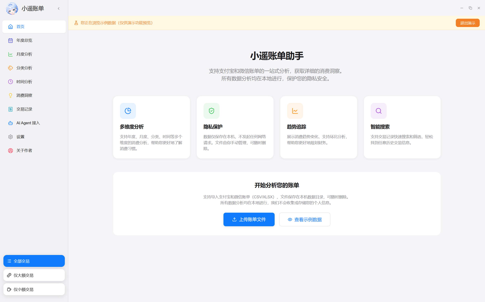</td>
<td width="50%">
<ul>
<li>🎯 One place to analyze Alipay and WeChat bills</li>
<li>📊 Four capability cards: analysis, privacy, trends, and search</li>
<li>🚀 Import real bills or load demo data in one click</li>
</ul>
</td>
</tr>
</table>

### Upload Bills - Native Import

<table>
<tr>
<td width="50%">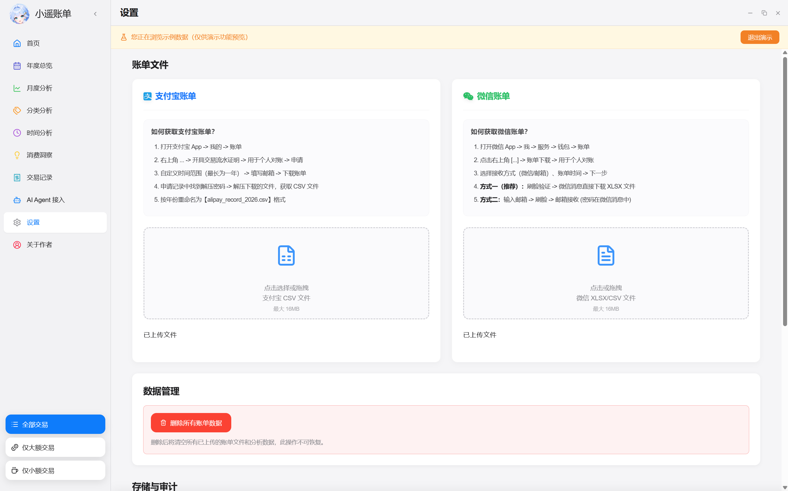</td>
<td width="50%">
<ul>
<li>📤 Native file dialog with multi-select and full-window drag &amp; drop</li>
<li>📋 Auto-detects Alipay / WeChat formats and encodings</li>
<li>⚡ Parsed locally, never uploaded to a server</li>
</ul>
</td>
</tr>
</table>

### Yearly Overview - At a Glance

<table>
<tr>
<td width="50%">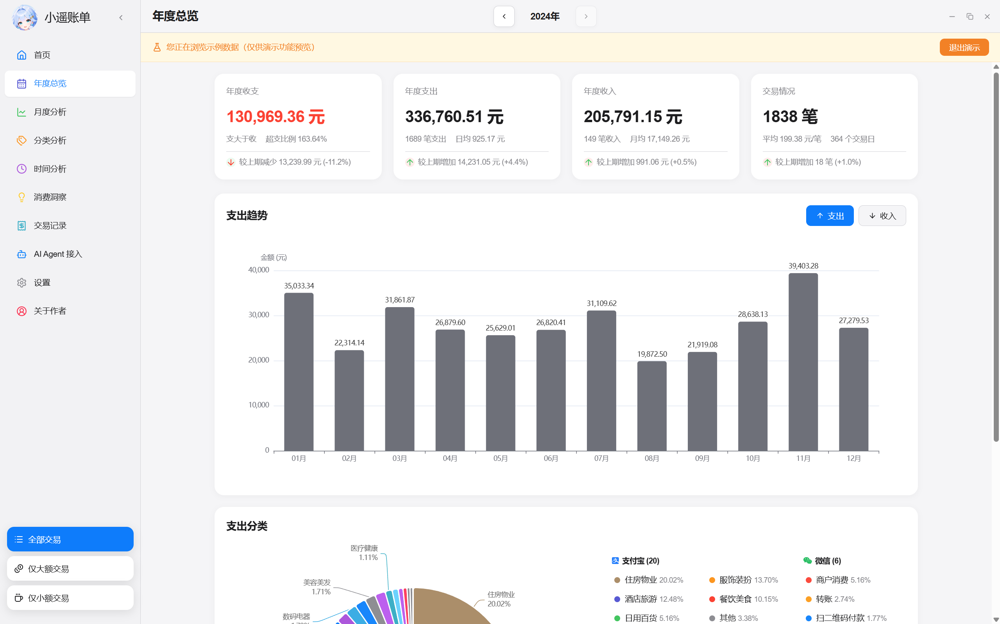</td>
<td width="50%">
<ul>
<li>📊 Yearly income, expense, balance, transaction count, and year-over-year change</li>
<li>📈 12-month expense trend with income toggle</li>
<li>🥧 Category share and source breakdown</li>
</ul>
</td>
</tr>
</table>

### Monthly Analysis - Detailed Comparison

<table>
<tr>
<td width="50%">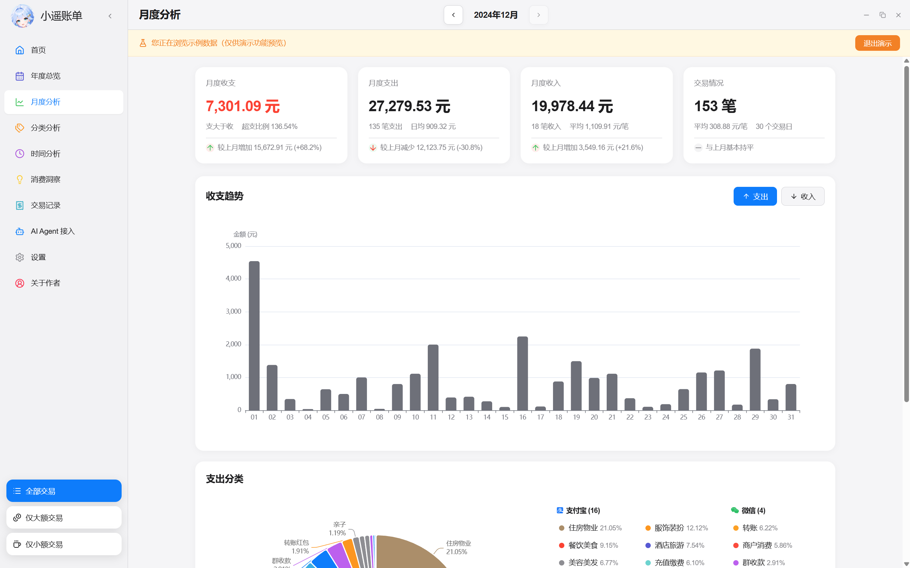</td>
<td width="50%">
<ul>
<li>📅 Monthly income, expense, month-over-month change, and daily average</li>
<li>🗓️ Daily spending calendar</li>
<li>📉 Month comparison and category details</li>
</ul>
</td>
</tr>
</table>

### Category Analysis - Where the Money Goes

<table>
<tr>
<td width="50%">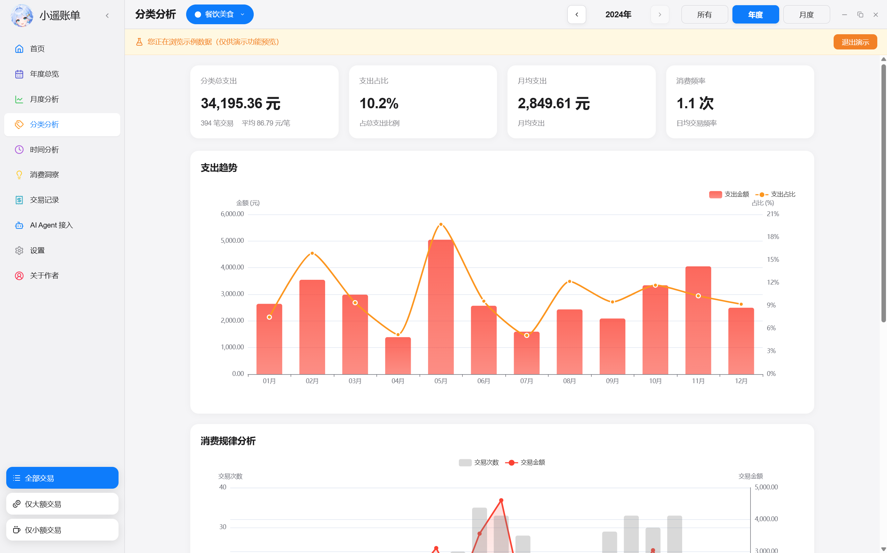</td>
<td width="50%">
<ul>
<li>🏷️ Category share and ranking</li>
<li>📊 Category trends and hourly distribution</li>
<li>📝 Drill-down into a single category</li>
</ul>
</td>
</tr>
</table>

### Time Analysis - Spending Rhythms

<table>
<tr>
<td width="50%">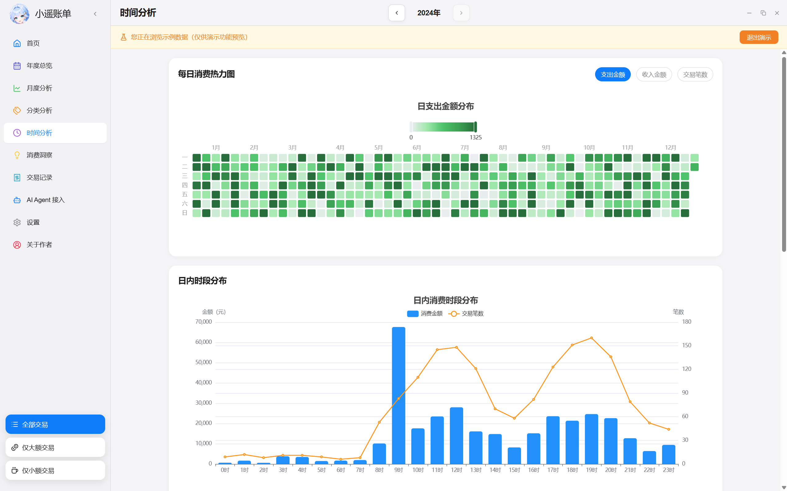</td>
<td width="50%">
<ul>
<li>⏰ 24-hour spending distribution</li>
<li>🌡️ Calendar heatmap</li>
<li>📈 Weekday / weekend comparison</li>
</ul>
</td>
</tr>
</table>

### Consumption Insights - Smart Analysis

<table>
<tr>
<td width="50%">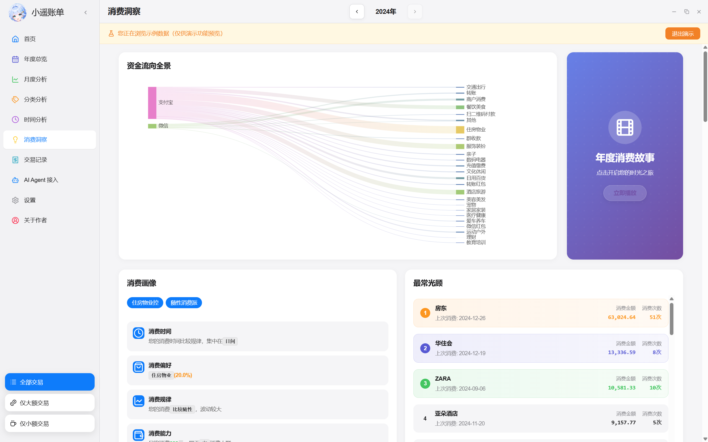</td>
<td width="50%">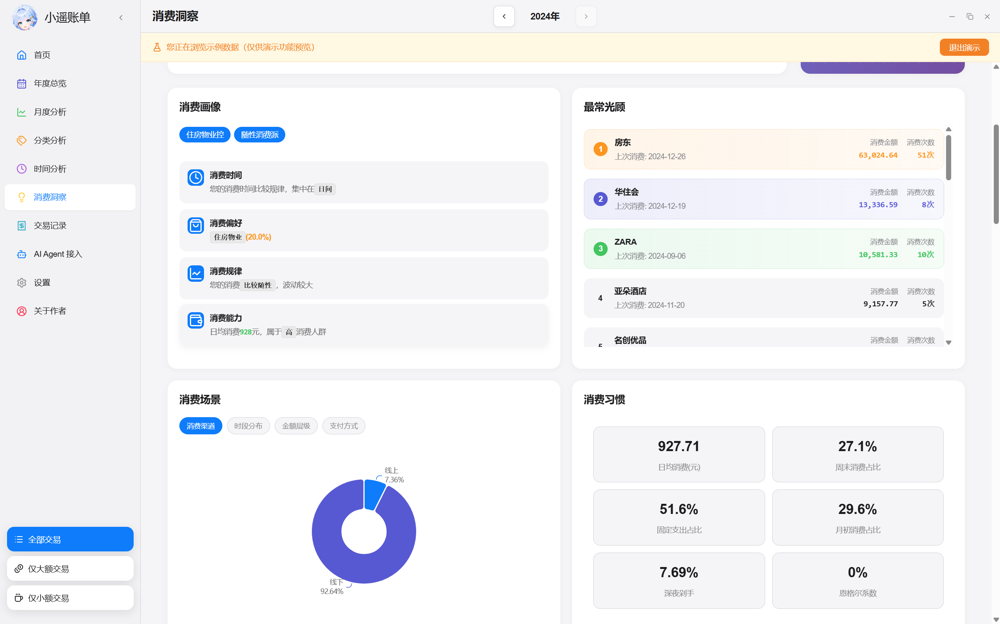</td>
</tr>
<tr>
<td width="50%">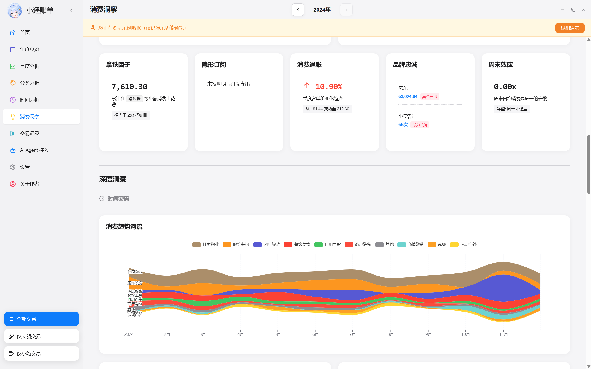</td>
<td width="50%">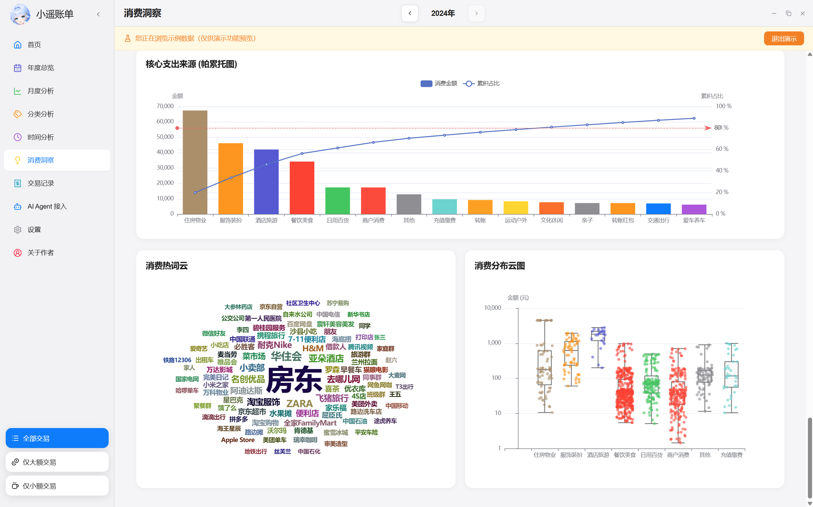</td>
</tr>
</table>

- 💡 Spending habits and user profile
- 🔍 Abnormal spending, latte factor, and late-night spending
- 📊 Subscription charges, Engel coefficient, and spending structure

### Transactions - Detailed Records

<table>
<tr>
<td width="50%">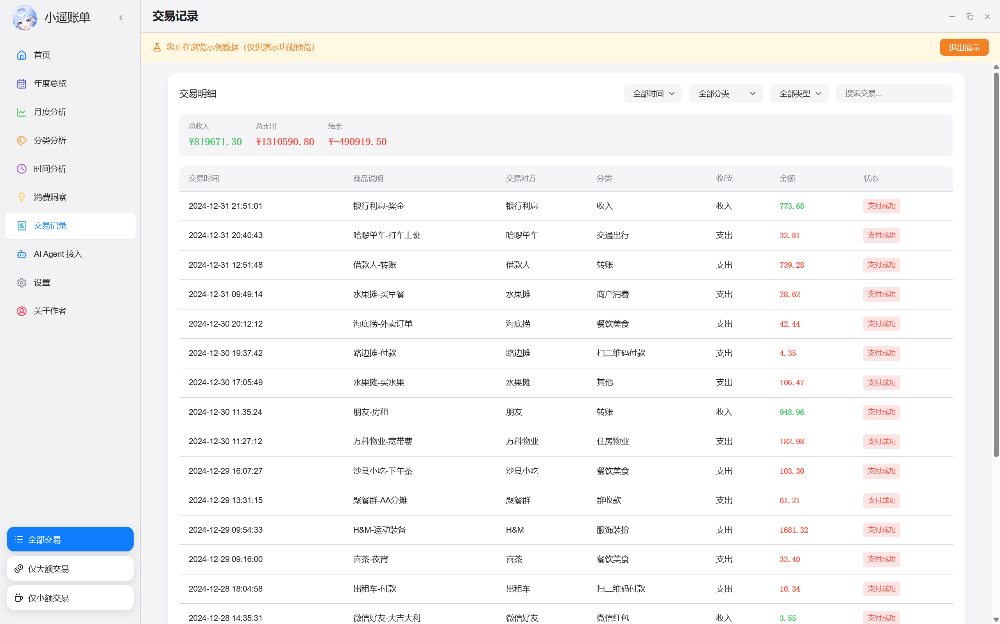</td>
<td width="50%">
<ul>
<li>📋 Complete transaction details</li>
<li>🔍 Keyword search and multi-dimensional filters</li>
<li>📄 Pagination with quick navigation</li>
</ul>
</td>
</tr>
</table>

---

## 3. AI Agent Integration (with XiaoyaoClaw as an Example)

<p align="center">
  <a href="https://www.xiaoyaosai.com/xiaoyaoclaw/"></a>
</p>

**XiaoyaoClaw** is a desktop Personal Agent that puts an AI assistant on your own computer. It runs locally, connects to local tools and data, and completes tasks for you in natural language.

Xiaoyao Private Bill Analyzer – Desktop ships a standard Streamable HTTP MCP server for XiaoyaoClaw. Once enabled, just say "Analyze my Xiaoyao bills for me" and XiaoyaoClaw automatically calls the bill tools, reads yearly, monthly, category, time, and insight data, and generates a structured analysis report. Your bills stay on your computer; whether they are sent to a model is controlled by your XiaoyaoClaw configuration.

**XiaoyaoClaw website**: <https://www.xiaoyaosai.com/xiaoyaoclaw/>

### 3.1 Enable MCP in the App

1. Open **AI Agent** in the sidebar.
2. Turn on the MCP switch; the status shows **Running**.
3. The server listens on `http://127.0.0.1:17650/mcp` only, bound to loopback and never exposed to the LAN or the internet.
4. Click **Copy MCP Config** to get the standard JSON that XiaoyaoClaw accepts.

> MCP is disabled by default. Once enabled, local programs can read all your bills; whether data leaves your machine depends on the calling agent and its configured model.

The config format is as follows (the token is generated by the app; always use the copied value):

```json
{
  "type": "http",
  "url": "http://127.0.0.1:17650/mcp",
  "headers": {
    "Authorization": "Bearer <TOKEN>"
  }
}
```

### 3.2 Add the Server in XiaoyaoClaw

<table>
<tr>
<td width="50%">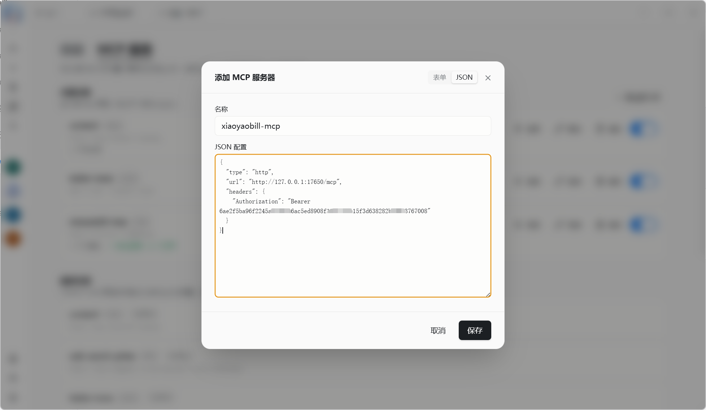</td>
<td width="50%">
<ol>
<li>Open <strong>Settings → Skills &amp; MCP</strong> in XiaoyaoClaw</li>
<li>Click <strong>Add Server</strong>; name it <code>xiaoyaobill-mcp</code></li>
<li>Switch to the <strong>JSON</strong> tab and paste the copied config</li>
<li>Click <strong>Save</strong></li>
</ol>
</td>
</tr>
</table>

### 3.3 Test the Connection

<table>
<tr>
<td width="50%"></td>
<td width="50%">
<ul>
<li>✅ Shows <strong>Connected · 14 tools</strong></li>
<li>🔑 Credentials use the Bearer token generated by the app</li>
<li>🔄 Changes take effect on the next message; no restart required</li>
</ul>
</td>
</tr>
</table>

### 3.4 Analyze Bills in Natural Language

Ask XiaoyaoClaw directly, for example: "Analyze my Xiaoyao bills for me."

<table>
<tr>
<td width="50%">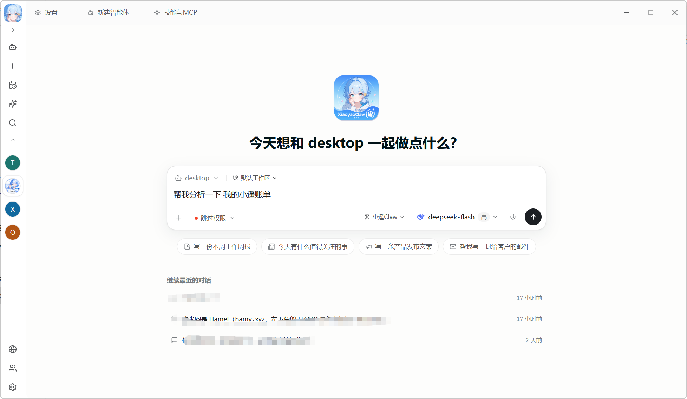</td>
<td width="50%">
<ul>
<li>🗣️ No tool names to memorize; the agent picks MCP tools automatically</li>
<li>📊 Combines overview, yearly, monthly, category, and insight calls</li>
<li>📝 Produces structured conclusions such as yearly summary and where the money goes</li>
</ul>
</td>
</tr>
</table>

<p align="center">
  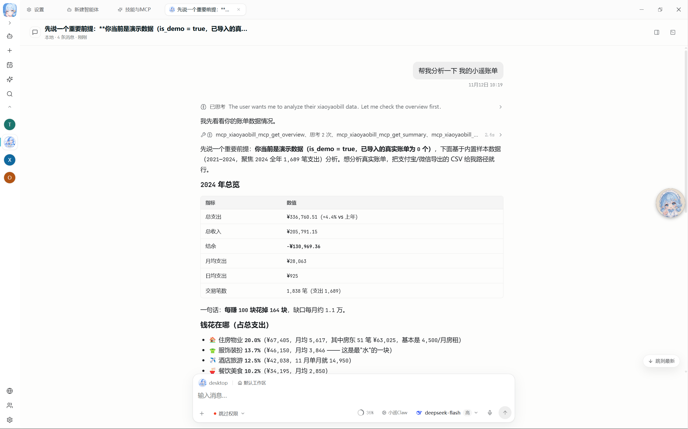
</p>

> The screenshot uses demo data. After importing real bills, the agent reads your latest local data; in demo mode it reports `is_demo = true`.

### 3.5 The 14 MCP Tools

| Type | Tools |
|---|---|
| Read (10) | `list_bills`, `get_overview`, `get_summary`, `get_yearly_analysis`, `get_monthly_analysis`, `get_category_analysis`, `search_transactions`, `get_time_analysis`, `get_insights`, `get_audit_log` |
| Write (4) | `import_bill`, `delete_bill`, `restore_bill`, `clear_data` |

Write operations are guarded: `import_bill` only accepts absolute paths up to 16MB; `delete_bill` moves to trash; `clear_data` takes a snapshot first; every write is recorded in the audit log. All writes are rejected in demo mode.

### 3.6 Security Notes

- The token is a 32-byte random value and can be regenerated in the app; old connections become invalid immediately.
- The server binds to `127.0.0.1` only, never to the LAN or the internet.
- Trash, snapshots, and the audit log are **never cleaned automatically**; clear them manually in the app.
- Keep MCP disabled if you do not need agent access.
- An agent may send tool results to its configured model; evaluate that model's privacy boundary yourself.

---

## 4. Installation

> Installers are not published yet. The release information below depends on the P6 packaging result. For now, please [build from source](#8-development--build).

### 4.1 Windows 10 / 11 (x64)

1. Download `*-setup.exe` from [GitHub Releases](https://github.com/dtsola/xiaoyaoprivatebill-desktop/releases).
2. Run the installer and follow the wizard. It installs per-user and does not require administrator rights.
3. Launch **Xiaoyao Private Bill Analyzer – Desktop** from the Start menu.

> Windows 10 requires the WebView2 runtime (included in Windows 11). If startup fails, install the [WebView2 Runtime](https://developer.microsoft.com/microsoft-edge/webview2/) first.

### 4.2 macOS 11+ (Intel / Apple Silicon)

1. Download the `.dmg` for your architecture from [GitHub Releases](https://github.com/dtsola/xiaoyaoprivatebill-desktop/releases):
   - Intel: `*_x64.dmg`
   - Apple Silicon: `*_aarch64.dmg`
2. Open the dmg and drag the app into **Applications**.
3. **First launch**: right-click the app → **Open**; or go to **System Settings → Privacy & Security** and click **Open Anyway**.
4. On macOS 15, if it is still blocked, run:

```bash
xattr -dr com.apple.quarantine "/Applications/小遥账单桌面版.app"
```

> The current build is **unsigned and not notarized**, hence the prompt above. Signing and notarization will be added in a later release.

### 4.3 System Requirements

| Item | Requirement |
|---|---|
| Windows | Windows 10 / 11 x64 with WebView2 |
| macOS | macOS 11+; Intel or Apple Silicon |
| Disk | Installer about 20MB; the data directory grows with your bills |
| Network | **Not required**; fully usable offline |

### 4.4 Data Directory and Uninstall

| Platform | Data directory |
|---|---|
| Windows | `%APPDATA%\xiaoyaobill-desktop` |
| macOS | `~/Library/Application Support/xiaoyaobill-desktop` |

- Uninstalling the app **does not** delete the data directory; remove it manually if you want a clean wipe.
- To back up, copy the entire data directory; `bills/` is the single source of truth.

---

## 5. Quick Start

### 5.1 Get Your Bill Files

**Alipay bills**:

1. Open the Alipay app → Bills.
2. Tap **Common Questions** in the top-right corner → Export bills.
3. Choose **Personal bills** → time range → CSV format.
4. Enter your email and wait for the file.

**WeChat bills**:

1. Open WeChat → Me → Services → Wallet → **Bills** in the top-right corner.
2. Tap **Common Questions** → Download bills.
3. Choose the time range → enter your email → choose CSV or XLSX.

### 5.2 Import and Analyze

1. Open the app and click **Upload Bills**, or go to **Settings**.
2. Choose a file in the Alipay / WeChat upload area, or drag a bill into the window.
3. Wait for parsing to finish, then explore yearly, monthly, category, time, insights, and transaction pages.
4. To try it first, click **View Demo Data** to load the built-in 7,396 records.

### 5.3 Demo Mode

- All analysis pages are available in demo mode.
- Import, delete, clear, and all MCP write operations are **blocked** in demo mode.
- Exit demo mode to return to your real data.

---

## 6. Privacy

| Item | Description |
|---|---|
| Network requests | The app itself makes no outbound requests; no telemetry, crash reports, or auto-update |
| Fonts and icons | Fonts and Lucide icons are bundled locally without a CDN; Alipay / WeChat / Bilibili brand icons are local too |
| Data storage | Stored only in the local app data directory; never uploaded to a server |
| Data cleanup | Deletes go to trash; clearing takes a snapshot first; the audit log records writes; all cleanup is manual |
| External links | Links such as About the Author open in the system browser |
| MCP | Disabled by default; loopback only; Bearer token; write auditing; whether data leaves the machine is up to the caller |
| Uninstall | Does not delete the data directory; remove it manually if needed |

---

## 7. Migrating from the Web Edition

- The desktop edition is a **separate product**; it does not read or migrate the Web edition's data directory.
- Visuals and statistical definitions are aligned, including known defects (such as Alipay refund handling).
- To migrate, simply re-import the original bill files into the desktop edition.
- The Web edition is frozen and receives security fixes only; new features ship in the desktop edition.
- Web edition source: [dtsola/xiaoyaoprivatebill](https://github.com/dtsola/xiaoyaoprivatebill).

---

## 8. Development & Build

### 8.1 Prerequisites

| Tool | Version |
|---|---|
| Rust | 1.95+ (MSVC toolchain on Windows) |
| Node.js | 20 LTS or 24 |
| npm | 10+ |
| Visual Studio Build Tools | 2022 (Windows, with VC Tools) |
| WebView2 | Windows 10 / 11 |
| Python | 3.10 (golden reconciliation only; not shipped) |

### 8.2 Local Development

```bash
# 1. Clone the repository
git clone https://github.com/dtsola/xiaoyaoprivatebill-desktop.git
cd xiaoyaoprivatebill-desktop

# 2. Install dependencies
npm install
npm --prefix frontend install

# 3. Start development mode (Vite + Tauri)
npm run tauri dev

# 4. Frontend-only development
npm --prefix frontend run dev
```

### 8.3 Build Installers

```bash
# Build the frontend
npm --prefix frontend run build

# Build the desktop installer (Windows NSIS)
npm run tauri build
# Output: src-tauri/target/release/bundle/nsis/*.exe
```

macOS builds run per architecture in GitHub Actions and produce `x86_64.dmg` and `aarch64.dmg`; the workflow is `.github/workflows/macos-build.yml`.

### 8.4 Quality and Reconciliation

```bash
cargo fmt --check
cargo clippy --workspace -- -D warnings
cargo test --workspace

# Frontend unit tests + Playwright desktop acceptance
npm run test:unit
npm run test:e2e

# Golden reconciliation (Python 3.10 + Web edition backend)
python tools/golden/generate.py --out fixtures/expected --check --web-root <Web repo>/backend

# Frontend frozen-baseline check
node scripts/check-frontend-baseline.mjs
```

Only 8 adaptation files and 9 icon-migration files may change in the frontend; all other pages, components, stores, and global styles stay frozen and are enforced by the baseline script in CI.

---

## 9. Documentation

| Document | Description |
|---|---|
| [Market Requirements (MRD)](docs/00-mrd.md) | Market problem, target users, competitors, success metrics |
| [Product Requirements (PRD)](docs/01-prd.md) | Features, desktop behavior, MCP, pages, acceptance |
| [Prototype & Visual Standard](docs/02-原型+视觉.md) | Page baseline, components, desktop group, import interaction, copy and visual acceptance |
| [Technical Design](docs/03-技术方案文档.md) | Tauri + Rust architecture, 27 APIs, storage, security, packaging |
| [Development Task List](docs/04-开发任务清单.md) | 61 tasks, effort, milestones, quality gates |
| [Development Schedule](docs/05-开发排期.md) | D1–D22, critical path, risks |
| [Development Progress](docs/开发进度.md) | Current progress, Web baseline, technical debt |
| [Architecture Decisions](docs/架构决策/) | Tauri spikes, MCP schema compatibility, and other decision records |

---

## 10. Acknowledgments

- The frontend and product design originate from [dtsola/xiaoyaoprivatebill](https://github.com/dtsola/xiaoyaoprivatebill) (Web edition, frozen).
- The Web edition was originally refactored from [alipay_record_analysis](https://github.com/Hessel2333/alipay_record_analysis); thanks to **Hessel2333**.
- The desktop edition is built with [Tauri](https://tauri.app/), [Rust](https://www.rust-lang.org/), [Vue 3](https://vuejs.org/), [ECharts](https://echarts.apache.org/), [rmcp](https://github.com/modelcontextprotocol/rust-sdk), and [Lucide](https://lucide.dev/).
- The AI Agent examples use [XiaoyaoClaw](https://www.xiaoyaosai.com/xiaoyaoclaw/).

---

## 11. Contributing

Contributions, issue reports, and suggestions are welcome.

### Workflow

1. Fork this repository.
2. Create a feature branch: `git checkout -b feature/AmazingFeature`.
3. Commit your changes: `git commit -m 'feat: add a feature'`.
4. Push the branch: `git push origin feature/AmazingFeature`.
5. Open a Pull Request.

### Coding Standards

- Rust follows `cargo fmt` and `cargo clippy -- -D warnings`.
- Only 8 adaptation files and 9 icon-migration files may change in the frontend; everything else stays frozen.
- Commit messages follow [Conventional Commits](https://www.conventionalcommits.org/).
- See [.claude/CLAUDE.md](.claude/CLAUDE.md) for details.

### Pre-commit Checks

```bash
cargo fmt --check
cargo clippy --workspace -- -D warnings
cargo test --workspace
npm run test:e2e
node scripts/check-frontend-baseline.mjs
```

---

## 12. License & Contact

This project is licensed under the [MIT License](LICENSE).

<p align="center">
  
</p>

<p align="center">
  <b>dtsola</b> — IT Solution Architect | Solo-company practitioner
</p>

<p align="center">
  🌐 <a href="https://www.dtsola.com">Personal site</a> &nbsp;|&nbsp;
  🏠 <a href="https://www.xiaoyaosai.com/">Xiaoyao website</a> &nbsp;|&nbsp;
  📺 <a href="https://space.bilibili.com/736015">Bilibili</a> &nbsp;|&nbsp;
  💬 WeChat: dtsola (technical exchange | business)
</p>

<p align="center">
  
  &nbsp;&nbsp;&nbsp;&nbsp;
  
  &nbsp;&nbsp;&nbsp;&nbsp;
  
</p>

<p align="center">
  <small>WeChat &nbsp;&nbsp;&nbsp;&nbsp;&nbsp;&nbsp;&nbsp;&nbsp; Developer group &nbsp;&nbsp;&nbsp;&nbsp;&nbsp;&nbsp;&nbsp;&nbsp; User group</small>
</p>

- Product website: [xiaoyaosai.com/xiaoyaoprivatebill-desktop](https://www.xiaoyaosai.com/xiaoyaoprivatebill-desktop/)
- XiaoyaoClaw: [xiaoyaosai.com/xiaoyaoclaw](https://www.xiaoyaosai.com/xiaoyaoclaw/)
- Repository: [GitHub](https://github.com/dtsola/xiaoyaoprivatebill-desktop)
- Issues: [GitHub Issues](https://github.com/dtsola/xiaoyaoprivatebill-desktop/issues)

---

**Made with ❤️ by Xiaoyao Team**
